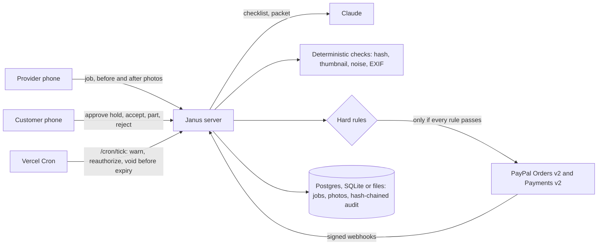

# Janus

**Get paid when the work is accepted.**

Janus is a payment hold for service jobs. The provider describes a job and Janus (with Claude) writes the
checklist. The customer approves a PayPal hold (Orders v2, `intent: AUTHORIZE`): the money is reserved before
work starts, but nothing is taken. The provider uploads before and after photos; Janus checks them and Claude
writes an acceptance packet. **Only the customer decides**: Accept (PayPal CAPTURE), pay part (a partial
CAPTURE, then VOID of the rest), or Reject (VOID, nothing charged). The provider is the PayPal merchant; Janus
never holds funds, it only tells PayPal to capture or void the customer's authorization.

## What the AI can and cannot do

- **Can:** turn the provider's description into a checklist, and judge the before and after photos item by item
  (pass, fail or unclear, with a confidence and a one-line reason), plus whether both photos show the same place
  and whether a photo looks edited.
- **Cannot:** move money. The packet is advice. No code path lets the AI, the scheduler, a webhook or the
  provider capture in a job; only the customer's own tap can.
- **Hard rules gate every capture** (`janus/rules.py`, listed [below](#hard-rules-checked-immediately-before-every-capture)),
  checked immediately before PayPal is called, independently of the AI and the policy.
- **A flagged packet needs a logged customer override**: ticking the override and giving a reason, stored as a
  consent bound to that exact packet and written to the audit trail. Rejecting never needs one.

## Try it live (PayPal Sandbox)

Live app: **https://usejanus.vercel.app/app**. It talks to PayPal Sandbox, so no real money moves. To approve a
hold you need **your own Sandbox buyer account**: on developer.paypal.com, open Testing Tools, Sandbox Accounts,
and use (or create) a Personal account. No credentials are published here.

1. Open the app, describe a small job and a price, tap **Write the checklist**. You are now the provider; copy the
   customer link (open it in a second window or on your phone).
2. As the customer, read the checklist and tap **Approve PayPal hold**. Log in to PayPal with your Sandbox buyer
   account and approve. You come back to the job page: "PayPal is holding ...".
3. As the provider, upload a before photo and an after photo, then tap **Build acceptance packet**.
4. As the customer, read the packet and choose Accept, pay part, or Reject. The PayPal record and the live audit
   trail on the page show each call; **Verify chain** re-checks the audit hashes.

The footer of the create page shows which PayPal mode, AI mode and storage the deployment runs.

## How PayPal is used

| Step | PayPal API |
|---|---|
| Customer approves the hold | Orders v2: create order with `intent: AUTHORIZE`, then authorize the approved order |
| Accept | Payments v2: capture the authorization (`final_capture: true`) |
| Pay part | capture with an amount and `final_capture: false`, then void the authorization (releases the rest) |
| Reject, or the hold is about to expire | void the authorization |
| After the 3-day honor period | reauthorize (once); if that is not possible, the customer is asked to approve a new hold |
| Hold lapsed before the customer decided | a fresh order with `intent: AUTHORIZE` for the same job; the old authorization is voided or has expired |
| Status changes | verified webhooks (PayPal's verify-webhook-signature API), each only triggers a fresh read from PayPal |

Every mutating call carries a `PayPal-Request-Id`, written to storage before the call, so retries and crash
recovery never capture twice.

## How AI is used

Claude (`claude-opus-5-5` by default, `JANUS_MODEL` to change it) through the Anthropic API with structured
outputs: once to write the checklist from the job description, and once per packet with both photos as images.
If Claude is unavailable the job goes to manual review (`no_ai_packet`) and the customer still decides. Without
`ANTHROPIC_API_KEY` a mock AI (pixel comparisons) runs so every path can be exercised offline; it does not judge
real work.

## Fraud checks that need no AI

These run on the photos before Claude sees them. Any hit is a blocking flag (manual review, override needed):

- **Reused photo**: a near copy of a photo from another job, or the before photo again. Caught by a 64-bit
  perceptual hash confirmed by a 32x24 thumbnail comparison, **not by Claude**.
- **Pasted or retouched area**: one connected area much smoother than the rest of the photo's sensor noise
  (`pixel_inconsistency`).
- **Editing app**: the EXIF `Software` tag names an editor.
- **Times that do not add up**: EXIF says the after photo was taken before the hold, before the before photo, or
  in the future.

Claude adds its own judgement on top (`wrong_room`, `likely_edited`, `possible_edit`); it never removes a flag.

## Architecture



Claude has no path to PayPal: its output only reaches the customer's page.

## Run locally

```bash
git clone https://github.com/levithefirst/janus && cd janus
./setup.sh                      # venv, dependencies, .env with a fresh JANUS_SECRET, full test suite
source .venv/bin/activate
python scripts/demo_jobs.py     # the two demo runs, end to end, in the terminal
python -m janus serve           # the app on http://localhost:8000 (phone-friendly)
pytest -q                       # tests (set JANUS_TEST_DATABASE_URL to include the Postgres backend)
```

With no keys, PayPal and the AI run as offline stand-ins. **Mock PayPal** uses PayPal's real error names,
replays by `PayPal-Request-Id`, and supports partial capture, void, reauthorize, refund and signed webhooks.
**Mock AI** compares pixels (room colours around the work area, how much the work area changed) and reads the
EXIF `Software` tag. To use the real services, see
[Run locally against PayPal Sandbox and Claude](#run-locally-against-paypal-sandbox-and-claude).

## Eval results (real Claude)

> **TODO: not run yet.** Run `python -m eval.run_eval --ai claude --write eval/results-claude.md` (needs
> `ANTHROPIC_API_KEY`) and paste the summary here. No Claude numbers are claimed until then.

Mock AI results, for comparison only (`eval/results-mock.md`, 13 synthetic cases; a check that the defences
fire, not a measurement of real-world error rates): **0 of 9** false accepts, **1 of 4** false rejects, 2 spurious
reuse flags. Details in [Eval](#eval).

## Security docs

[THREAT_MODEL](docs/THREAT_MODEL.md) (actors, trust boundaries) · [ATTACKS](docs/ATTACKS.md) (every known attack,
severity, status and the test that proves it) · [HARD_QUESTIONS](docs/HARD_QUESTIONS.md) (expiry, disputes,
AI mistakes) · [CONFIDENCE](docs/CONFIDENCE.md)

---

## Demo script: the two runs

`python scripts/demo_jobs.py` performs both runs and verifies each audit chain. In the browser
(`python -m janus serve`, or the deployed app), open the provider and customer links in two windows:

**Run 1: good job, partial capture, void of the rest**
1. Provider: open `/` (deployed: `/app`), enter *Patch a hole in the living room wall*, a description and a
   price, tap **Write the checklist**. Copy the customer link.
2. Customer: open the link, read the checklist, tap **Approve PayPal hold** (Sandbox: log in as the Sandbox
   personal account and approve). The page shows "PayPal is holding ...".
3. Provider: upload a **before** photo, then an **after** photo from the same spot, tap **Build acceptance packet**.
4. Customer: the packet shows pass, fail or unclear per checklist item, with a confidence and a one-line reason.
   Enter an amount under **Or pay part** and tap **Pay part, release the rest**.
5. Both pages show "Partly paid". The PayPal record shows one partial capture; the authorization is VOIDED.
   The audit trail lists the capture and the void, and **Verify chain** reports it intact.

**Run 2: reused photo, flagged, rule blocks, customer rejects, void**
1. Provider: create a second job, and upload run 1's after photo as this job's after photo.
2. Customer: the packet is in **manual review** and flagged: "This photo, or a near copy, was already used on
   another job." Tapping **Accept** without ticking the override is refused (HTTP 409); no PayPal call is made.
3. Customer: tap **Reject**. The hold is voided; nothing is charged. The audit trail shows the packet, the
   rejection and the PayPal void.

## My jobs, status, money and help

- **My jobs** (`/app/jobs`): every job opened on this browser, as customer or provider, with Active and Completed
  tabs, a status badge, amounts held and captured, and recent activity read from the audit trails. Janus has no
  accounts: a job is reached by its secret link, so the list is the jobs whose link this browser opened, each
  re-checked against its token.
- **Job page**: a status timeline (Created, Authorized, Evidence submitted, AI packet ready, Decision, outcome) above
  the audit trail; a money card (authorized, captured, still held or voided, Janus fee 0.00, hold expiry and the date
  Janus releases it); Pay part shows the exact amounts captured and released before the customer confirms.
- **Profile** (`/app/profile`) and **How it works and FAQ** (`/app/help`), linked from the nav and footer.

## The acceptance packet

For each checklist item: **pass / fail / unclear**, a **confidence** (0 to 1) and a **one-line reason** from the
model. Plus two integrity judgements from the model, scene match (same place before and after?) and edit signs,
and deterministic checks that need no AI:

| Flag | Raised when |
|---|---|
| `reused_photo` | a photo is a near copy of one uploaded to another job (64-bit perceptual hash, confirmed by a 32x24 thumbnail) |
| `after_matches_before` | the after photo is near-identical to the before photo |
| `edited_software` | the EXIF `Software` tag names an editing app (Photoshop, Snapseed, Lightroom, ...); camera firmware does not count |
| `pixel_inconsistency` | one connected area of the after photo is much smoother than the rest of its sensor noise (pasted, blurred or retouched); thresholds and their calibration are in `janus/evidence.py` |
| `likely_edited`, `possible_edit` | the model sees signs of editing |
| `wrong_room` | the model says before and after are different places |
| `after_taken_before_authorization`, `after_older_than_before`, `taken_in_future` | EXIF capture times are inconsistent |
| `no_before_photo`, `no_after_photo`, `photo_quality` | nothing to compare, or the photo is too dark, blurry or small |
| `no_ai_packet` | the AI was unavailable: the **manual-review fallback** |

Any flag puts the job in `manual_review`. **A flagged packet cannot be captured unless the customer ticks the
override and says why.** The override is stored as a consent bound to that exact packet and the current terms,
and written to the audit trail. A new packet (the provider re-uploads) needs a new override. Rejecting never
needs one.

Missing EXIF raises the confidence bar a little; EXIF that is present never lowers it. Browser uploads up to 3 MB
are sent as is, so EXIF survives; larger photos are shrunk on the phone (Vercel limits request bodies to 4.5 MB)
and lose it.

## Hard rules, checked immediately before every capture

From `janus/rules.py`, independent of the policy and the AI:

1. A recorded customer consent bound to the current terms (condition, price, checklist).
2. An automatic capture (threshold mode only) needs a verdict at or above the confidence bar.
3. Never after a void or expiry, or past the authorization's expiry time.
4. Nothing changes a job in a terminal state.
5. The scheduler, webhooks and the provider can never capture.
6. No automatic capture while a dispute or amendment is open.
7. In a job, only the customer can capture.
8. In a job, a flagged packet needs the customer's override for that packet.
9. One live hold per job: a capture runs only on the current authorization (never one a renewal replaced),
   and the total captured across all of a job's authorizations never exceeds its price.

Capture amounts must be positive. Every check (pass or block) goes into the audit trail.

## Hold lifecycle

- **Expiry**: an authorization is honored for 3 days and expires after 29 (`janus/constants.py`, with sources).
  The scheduler warns 12 hours before day 3, reauthorizes once (`MAX_REAUTHORIZATIONS = 1`; PayPal's docs
  conflict on the limit) or flags that a new authorization is needed, and **voids 48 hours before day 29**, so a
  once-a-day cron still lands in time. It never captures.
- **Lapsed hold**: in a job, a hold that expires or is voided before the customer decides does not close the job.
  The job moves to `hold_lapsed` and the customer sees **Approve a new hold**: a new PayPal order for the same job,
  same checklist and photos. The old order and authorization are linked in the audit chain. If reauthorization
  was not possible and the old hold is still open, the new hold is authorized first and then the old one voided.
  A late capture on the old hold always wins: the new hold is never authorized, or is voided at once. Rule 9
  stops a capture on a replaced authorization and any total above the price.
- **Scheduling**: `python -m janus tick`, every `JANUS_TICK_SECONDS` inside `serve`, or Vercel Cron calling
  `/app/cron/tick` with `Authorization: Bearer $CRON_SECRET` (daily in `vercel.json`, the Hobby plan limit).
- **Retries**: every mutating PayPal call carries `PayPal-Request-Id: janus-<job>-<action>[-n]`. The exact
  request is written to storage before PayPal is called, so after a crash `recover()` replays it with the same
  key. A partial capture followed by a crash finishes with the void, never a second capture.
- **Not yet measured**: how many reauthorizations PayPal allows, and how long it honors a request id.
  `scripts/measure_sandbox.py` records both against the live Sandbox; see TODO(sandbox) in `constants.py`.
  No result is claimed until it has been run.

## Audit trail

Every job has its own append-only chain. Each entry holds the SHA-256 of the previous entry and its own hash.
It records every PayPal call, every rule check, every AI request and output, every state change, and every user
action (consent, uploads, accept, partial, reject, override). The job page shows it live and can re-verify it.

- `GET /api/t/<id>/audit` (`?after=n` for new entries) and `GET /api/t/<id>/audit/verify`, with the job's token.
- `python -m janus audit` verifies the global chain.

## Eval

`python -m eval.run_eval` runs 13 synthetic before/after cases (4 good, 3 reused, 3 wrong room, 3 edited)
through the real job pipeline and prints false accepts and false rejects. The cases are drawings, built at run
time. It shows which defences fire; it is **not** a measurement of real-world error rates.

Result with the mock AI, as produced (`eval/results-mock.md`):

- **False accepts: 0 of 9** bad cases. `edited-pasted` (a pixel edit with no editor tag) used to be the one false
  accept; the deterministic noise-consistency check now sends it to manual review (`pixel_inconsistency`).
- **False rejects: 1 of 4** good cases (`good-outlet`: the mock's change detector misses a small repair).
- **Spurious reuse flags: 2** (before photos of different jobs in a similar-looking room).

With Claude: not run yet; see [Eval results (real Claude)](#eval-results-real-claude).

## Deploy on Vercel

The app is one Python function (`api/index.py`). It needs Postgres, because serverless functions have no
persistent disk.

1. **Storage.** In the Vercel dashboard: Storage, Create, **Neon** (Postgres via the Marketplace), connect it to
   the project. That sets `DATABASE_URL` and `DATABASE_URL_UNPOOLED`; Janus prefers the unpooled one because it
   holds Postgres advisory locks, which a transaction pooler drops. Tables are created on first use.
2. **Project.** Two ways to serve it at `https://usejanus.vercel.app/app` without touching the landing page or
   `/api/auth`:
   - **Separate project (recommended).** Deploy this repo as its own project (for example `janus-app`:
     `vercel link`, then `vercel --prod`). In the landing project's `vercel.json`, add three rewrites next to the
     existing `/api/auth` one:
     ```json
     { "source": "/app", "destination": "https://janus-app.vercel.app/app" },
     { "source": "/app/:path*", "destination": "https://janus-app.vercel.app/app/:path*" },
     { "source": "/paypal/:path*", "destination": "https://janus-app.vercel.app/paypal/:path*" }
     ```
   - **Same project.** Copy `api/index.py`, `janus/` and `requirements.txt` into the landing project, and merge
     this repo's `vercel.json` (`functions`, `rewrites`, `crons`) into its own.
3. **Environment variables** (Production):

   | Variable | Value |
   |---|---|
   | `JANUS_SECRET` | `python -m janus secret` (signs links and photo URLs) |
   | `JANUS_BASE_URL` | `https://usejanus.vercel.app/app` |
   | `PAYPAL_CLIENT_ID`, `PAYPAL_CLIENT_SECRET` | Sandbox app credentials (developer.paypal.com, Apps & Credentials, Sandbox) |
   | `PAYPAL_WEBHOOK_ID` | from step 4 |
   | `ANTHROPIC_API_KEY` | for the Claude packet (without it the mock AI runs) |
   | `DATABASE_URL_UNPOOLED`, `DATABASE_URL` | set by the Neon integration |
   | `CRON_SECRET` | any long random string; Vercel Cron sends it |

   `api/index.py` sets `JANUS_MOUNT=/app` and `JANUS_DATA_DIR=/tmp/janus` (a read cache only).
4. **PayPal webhook.** developer.paypal.com, your Sandbox app, Webhooks, Add webhook:
   URL `https://usejanus.vercel.app/paypal/webhook`; events `PAYMENT.AUTHORIZATION.CREATED`,
   `PAYMENT.AUTHORIZATION.VOIDED`, `PAYMENT.CAPTURE.COMPLETED`, `PAYMENT.CAPTURE.DENIED`,
   `PAYMENT.CAPTURE.REFUNDED`. Copy its Webhook ID into `PAYPAL_WEBHOOK_ID`. Each delivery is verified with
   PayPal's verify-webhook-signature API (without `PAYPAL_WEBHOOK_ID` every webhook is refused), claimed once by
   event id, and only triggers a fresh read of the authorization from PayPal, so duplicates and out-of-order
   deliveries are harmless.
5. **Cron.** `vercel.json` schedules `/app/cron/tick` daily. On Pro, change the schedule to hourly.

## Run locally against PayPal Sandbox and Claude

```bash
cp .env.example .env    # fill PAYPAL_CLIENT_ID, PAYPAL_CLIENT_SECRET, ANTHROPIC_API_KEY
python scripts/demo_jobs.py --wait 600    # prints each approval URL; approve with a Sandbox personal account
```

For the browser flow on a phone, expose `python -m janus serve` through a tunnel and set `JANUS_BASE_URL` to the
public URL (PayPal redirects the customer back to `JANUS_BASE_URL/paypal/return`).

## HTTP API

Creating a job returns a provider link (`?k=`) and a customer link (`?t=`); API calls send that token in
`X-Janus-Token`. A missing job and a wrong token both answer 404. Errors are JSON (400, 401, 409 for a step not
allowed or an override required, 429, 502).

```bash
curl -s localhost:8000/api/jobs -d '{"title":"Patch wall hole","price":"120","description":"Patch the hole. Paint it."}'
curl -s -H "X-Janus-Token: <PROVIDER>" localhost:8000/api/t/<id>/photo -d '{"phase":"before","photo_b64":"<base64>"}'
curl -s -H "X-Janus-Token: <PROVIDER>" localhost:8000/api/t/<id>/photo -d '{"phase":"after","photo_b64":"<base64>"}'
curl -s -H "X-Janus-Token: <PROVIDER>" -X POST localhost:8000/api/t/<id>/verify          # the packet
curl -s -H "X-Janus-Token: <CUSTOMER>" localhost:8000/api/t/<id>/partial -d '{"amount":"80.00"}'
curl -s -H "X-Janus-Token: <CUSTOMER>" localhost:8000/api/t/<id>/accept -d '{"override_reason":"I checked it"}'
curl -s -H "X-Janus-Token: <CUSTOMER>" localhost:8000/api/t/<id>/reject -d '{"reason":"not done"}'
curl -s -H "X-Janus-Token: <CUSTOMER>" localhost:8000/api/t/<id>/audit/verify
```

The customer approves the hold with a form POST from the job page (`POST /t/<id>/pay`, bound to the terms hash),
and a new hold after a lapse with `POST /t/<id>/renew` (or `POST /api/t/<id>/renew`, which returns the approval URL).
A job that captured part and voided the rest ends in state `partially_captured`.

## Threshold mode

The earlier flow is still there: a seller states a condition about an item, the buyer photographs what arrived,
and under the buyer's prior consent a confident verdict can capture or void automatically. Create one at
`/threshold`, or `python -m janus demo`. See [docs/CONFIDENCE.md](docs/CONFIDENCE.md).

## Layout

```
api/index.py         Vercel entry point
janus/web_jobs.py    job pages: create, status for both sides, packet, decision, live audit
janus/server.py      routing, roles, mount, cron, webhooks
janus/service.py     every step: jobs, packet, accept/partial/reject, settlement, recovery, scheduler hooks
janus/rules.py       hard rules checked before every capture
janus/evidence.py    quality gate, reuse detection, EXIF checks, job flags
janus/ai.py          Claude and mock: checklist, packet, threshold verdicts
janus/kv.py          storage backends: files, SQLite, Postgres
janus/audit.py       hash-chained audit trails, global and per job
janus/paypal.py      Orders v2 / Payments v2 Sandbox client and offline mock
eval/                eval cases, scene generator, runner, results
scripts/             demo_jobs.py (the two runs), measure_sandbox.py (open PayPal questions)
```

## License

MIT, see `LICENSE`.
